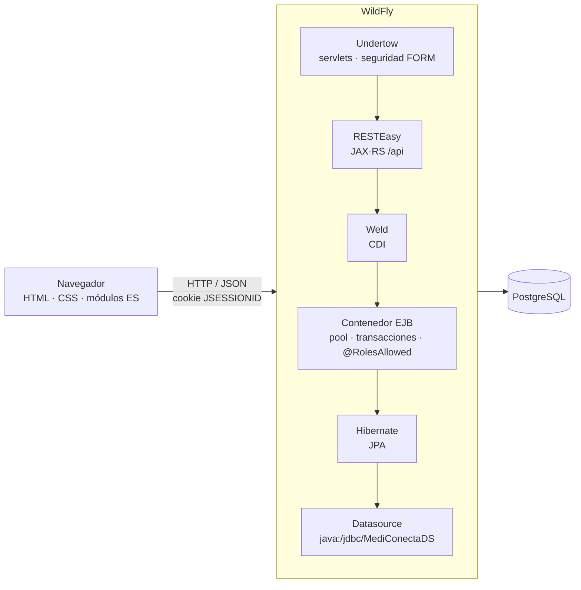
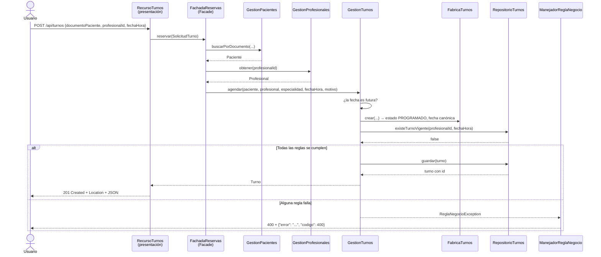

# MediConecta — Entrega Obligatoria N.º 1

**Trabajo Práctico Integrador — Desarrollo de Aplicaciones II — UADE**
**Primer parcial**

| | |
|---|---|
| **Sistema** | MediConecta — gestión de turnos médicos |
| **Plataforma** | Jakarta EE 10 · Java 17 · Maven · WAR |
| **Contenedor** | WildFly (verificado sobre 41.0.1.Final) |
| **Base de datos** | PostgreSQL (verificado sobre 16.14) |
| **Context root** | `/mediconecta` |
| **Repositorio** | <https://github.com/tobiasbonomo29/desarrollo-de-apps2> |

---

## 1. Objetivo de la entrega

Construir la primera versión funcional de MediConecta sobre un contenedor Jakarta EE real,
con componentes de negocio propios del dominio y no con ejemplos de "hola mundo".

En concreto, esta entrega tiene que demostrar:

1. **componentes EJB reales**, al menos tres, con un `@Stateless` y un `@Stateful` de
   verdad;
2. **arquitectura en capas** presentación / negocio / datos, con dependencias en un solo
   sentido;
3. **patrones de diseño** aplicados porque resuelven un problema concreto, no para llenar
   una lista;
4. **seguridad declarativa** administrada por el contenedor, con autenticación y
   autorización por roles;
5. **persistencia** con JPA sobre PostgreSQL, reemplazando el almacenamiento en memoria de
   la versión anterior;
6. una **aplicación usable**, no una colección de endpoints.

Todo lo anterior está implementado y se puede mostrar en vivo. Lo que no está implementado
—mensajería asincrónica e integración con sistemas externos— corresponde a entregas
posteriores y está identificado como tal.

---

## 2. Arquitectura general

MediConecta es una aplicación web empaquetada como un único WAR y desplegada en WildFly. No
hay microservicios ni procesos auxiliares: el contenedor Jakarta EE administra todo el ciclo
de vida.



Qué administra el contenedor y qué escribe el equipo:

| Lo administra WildFly | Lo escribe el equipo |
|---|---|
| Ciclo de vida de los EJB (pool, creación, destrucción, *timeout*) | Las reglas del dominio |
| Transacciones JTA (apertura, *commit*, *rollback*) | El modelo y las consultas del repositorio |
| Autenticación de usuarios y evaluación de `@RolesAllowed` | La declaración de qué rol puede qué |
| Pool de conexiones a PostgreSQL | La interfaz de usuario |
| Serialización JSON, enrutamiento REST, inyección de dependencias | |

El WAR pesa alrededor de 120 kB porque la única dependencia (`jakarta.jakartaee-api`) está
en scope `provided`: las implementaciones las aporta el servidor.

---

## 3. Componentes implementados

| # | Componente | Tipo | Operaciones principales |
|---|---|---|---|
| C1 | `GestionTurnos` | `@Stateless` | `listarTurnos`, `obtenerTurno`, `agendar`, `cancelarTurno`, `turnosDelDia`, `turnosDePaciente`, `horariosOcupados` |
| C2 | `GestionPacientes` | `@Stateless` | `listarPacientes`, `buscar`, `buscarPorDocumento`, `registrarPaciente`, `actualizarDatos`, `historialDeTurnos`, `miFicha` |
| C3 | `GestionProfesionales` | `@Stateless` | `listarProfesionales`, `listarPorEspecialidad`, `listarEspecialidades`, `registrarProfesional`, `definirDisponibilidad`, `horariosLibres` |
| C4 | `AsistenteReservaTurno` | **`@Stateful`** | `iniciar`, `elegirEspecialidad`, `elegirProfesional`, `elegirHorario`, `volver`, `confirmar`, `finalizar` |
| — | `FachadaReservas` | `@Stateless` | `reservar`, `resumenDelDia`, `especialidades`, `profesionalesDe`, `horariosLibres` |

### Reglas de negocio que aplica cada uno

**C1 — GestionTurnos**

- el paciente y el profesional tienen que existir;
- la fecha tiene que ser válida y **futura**;
- un profesional no puede tener dos turnos vigentes en el mismo horario;
- todo turno nace `PROGRAMADO`; el cliente HTTP no puede elegir el estado;
- un turno cancelado **no** bloquea su horario: vuelve a estar disponible;
- no se puede cancelar dos veces, ni cancelar un turno ya atendido.

**C2 — GestionPacientes**

- documento obligatorio y **único**; nombre obligatorio;
- el documento identifica al paciente y no se puede modificar: cambiarlo sería dar de alta a
  otra persona;
- un usuario con rol PACIENTE sólo puede consultar **su propio** historial.

**C3 — GestionProfesionales**

- nombre, especialidad y matrícula obligatorios; matrícula única;
- cada franja de disponibilidad necesita día, hora de inicio anterior a la de fin y una
  duración mayor a cero;
- los horarios libres se calculan partiendo la franja del día de la semana en intervalos,
  descontando los turnos vigentes y descartando los que ya pasaron.

**C4 — AsistenteReservaTurno**

- los pasos tienen un orden: no se puede elegir profesional sin haber elegido especialidad;
- el profesional tiene que atender la especialidad elegida;
- el horario tiene que seguir libre en el momento de elegirlo;
- al confirmar **no repite ninguna regla**: arma una `SolicitudTurno` y la pasa por
  `FachadaReservas`, el mismo camino que usa el alta directa.

### Componentes futuros, ya identificados

| # | Componente | Entrega |
|---|---|---|
| C5 | `Notificaciones` — avisos por cola y tópico | 3 |
| C6 | `IntegracionObrasSociales` — SOAP + REST, patrón Adapter | 4 |

No hay código de estos dos componentes en el proyecto: ni interfaces vacías ni *stubs*.

---

## 4. Arquitectura en capas

```
com.mediconecta
├── modelo/         Paciente · Profesional · Disponibilidad · Turno · EstadoTurno
├── datos/          RepositorioTurnos · RepositorioPacientes · RepositorioProfesionales
│   ├── jpa/        implementaciones sobre PostgreSQL (activas)
│   └── memoria/    implementaciones en memoria (@Alternative, desactivadas)
├── negocio/        los cuatro componentes + FachadaReservas + FabricaTurnos + excepciones
└── presentacion/   recursos JAX-RS · ExceptionMappers · ServletLogin · ConversacionDeReserva
```

**La regla:** presentación conoce a negocio, negocio conoce a datos, datos no conoce a
nadie. El modelo lo atraviesan las tres sin generar acoplamiento, porque no tiene lógica.

**Qué hace cada una:**

- **Presentación** habla HTTP y JSON. Traduce el pedido, delega y arma la respuesta. No
  valida reglas, no ordena resultados, no toca el almacenamiento. Los `ExceptionMapper`
  convierten las excepciones del dominio en 400, 403 y 404.
- **Negocio** es el único lugar donde viven las reglas y las decisiones de autorización. Sus
  excepciones **no mencionan HTTP**, que es lo que permitirá exponer el mismo negocio por
  SOAP o desde una cola sin tocarlo.
- **Datos** es la única capa que conoce `EntityManager`. Sus interfaces están escritas en el
  lenguaje del dominio.

**Cómo se comprueba que la separación es real:** buscando `import jakarta.persistence` fuera
del paquete `datos` (sólo aparece en `modelo`, por las anotaciones de entidad) y
`import jakarta.ws.rs` fuera de `presentacion` (no aparece en ningún lado).

### Recorrido de un alta de turno



---

## 5. Stateless y stateful

### El criterio

Un componente es **stateless** cuando no conserva estado de conversación con un cliente
entre invocaciones. Es **stateful** cuando sí, porque una operación del negocio se
desarrolla a lo largo de varias llamadas.

### Los tres stateless

`GestionTurnos`, `GestionPacientes` y `GestionProfesionales` no tienen ningún campo de
instancia que guarde resultados: los únicos atributos son referencias inyectadas a
colaboradores. Cada método recibe todo lo que necesita, resuelve y termina.

Consecuencias comprobables:

- el orden de las llamadas no cambia el resultado;
- dos requests del mismo usuario pueden ser atendidos por instancias distintas del pool sin
  diferencia observable;
- el contenedor mantiene un pool acotado y lo reutiliza entre clientes.

### El stateful

`AsistenteReservaTurno` guarda `documentoPaciente`, `especialidad`, `profesionalId`,
`fechaHora` y `paso` **entre request y request**.

**La prueba que no admite discusión** está en el contrato de la API:

```http
PUT /api/reserva/profesional
Content-Type: application/json

{ "profesionalId": 1 }
```

El request **no** lleva el paciente ni la especialidad. La respuesta, sin embargo, los
incluye:

```json
{
  "idConversacion": "53785cd6",
  "instancia": "3a49aa3f",
  "pasoActual": "ELEGIR_HORARIO",
  "documentoPaciente": "30111222",
  "nombrePaciente": "Ana Gomez",
  "especialidad": "Cardiologia",
  "profesionalId": 1,
  "nombreProfesional": "Dra. Laura Fernandez"
}
```

El navegador sólo envió la cookie `JSESSIONID`. Todo lo demás lo recordó el servidor.

### El puente con la sesión HTTP

Un EJB stateful no se ata solo a una sesión web. `ConversacionDeReserva` es un bean CDI
`@SessionScoped` que guarda la referencia al asistente; CDI lo asocia a la cookie de sesión.
Se inyecta `Instance<AsistenteReservaTurno>` —y no el EJB directamente— porque hace falta
poder destruir la instancia al terminar la conversación y pedir una nueva para la siguiente
reserva.

---

## 6. Ciclo de vida

El ciclo de vida de los componentes lo administra **íntegramente el contenedor**. La
aplicación no hace `new` de ningún EJB.

| Anotación | Quién la invoca | Cuándo | Para qué en MediConecta |
|---|---|---|---|
| `@PostConstruct` | contenedor | tras crear la instancia e inyectar sus dependencias | abre la conversación y le asigna identificador; también carga el juego de datos de ejemplo en `CargaDeDatosDemo` |
| `@Remove` | la aplicación | al confirmar o abandonar la reserva | le avisa al contenedor que la conversación terminó |
| `@PreDestroy` | contenedor | justo antes de descartar la instancia | deja registro del cierre en el log |
| `@StatefulTimeout` | contenedor | 30 minutos sin actividad | libera la instancia si el usuario abandona a mitad de camino |
| `@Startup` + `@Singleton` | contenedor | al desplegar el WAR | carga los datos de demostración una sola vez |

Durante la defensa, el log muestra la secuencia completa:

```
[STATEFUL] @PostConstruct - el contenedor creo el asistente f851323c (instancia 136b1919)
[STATEFUL] conversacion f851323c iniciada para el paciente 30111222
[STATEFUL] conversacion f851323c recuerda especialidad=Cardiologia
[STATEFUL] conversacion f851323c recuerda profesional=Dra. Laura Fernandez
[STATEFUL] conversacion f851323c recuerda horario=2026-09-18T09:00
[STATEFUL] conversacion f851323c confirmada: turno 16
[STATEFUL] @Remove - fin de la conversacion f851323c en el paso 5
[STATEFUL] @PreDestroy - el contenedor descarta el asistente f851323c (instancia 136b1919)
[STATEFUL] @PostConstruct - el contenedor creo el asistente a3d3c55b (instancia 6cb82941)
```

El identificador de instancia se muestra también en la pantalla de reserva: sirve para
probar en vivo que entre paso y paso es **el mismo objeto**, y que después de confirmar es
**otro distinto**.

---

## 7. Patrones de diseño

Los tres patrones están implementados porque resuelven un problema concreto del sistema. El
detalle completo —problema, solución, ubicación, motivo y alternativa descartada— está en
[arquitectura.md, sección 4](arquitectura.md#4-patrones-de-diseño). Resumen:

| Patrón | Dónde | Problema que resuelve | Prueba de que aporta |
|---|---|---|---|
| **DAO / Repository** | `datos` — tres interfaces, dos juegos de implementaciones | Migrar de memoria a JPA sin reescribir las reglas del dominio | La migración se hizo escribiendo tres clases nuevas; negocio y presentación quedaron sin cambios. Las implementaciones en memoria siguen disponibles como `@Alternative` |
| **Facade** | `FachadaReservas` | Reservar involucra tres componentes, y hay **dos** clientes distintos (REST y el asistente stateful) que harían la misma secuencia | Sin la fachada, esa coreografía quedaría duplicada en dos lugares que se desincronizarían |
| **Factory** | `FabricaTurnos` | Un turno bien formado exige estado inicial, fecha truncada al minuto y especialidad coherente; hay **tres** caminos que crean turnos | Si un camino olvidara truncar la fecha, la regla de superposición dejaría de detectar choques. Ese defecto ya ocurrió en la versión anterior |

**Por qué todavía no hay Adapter.** Adapter es el patrón natural de la Entrega 4, donde hay
que hablar con una obra social por SOAP y con otra por REST detrás de una misma interfaz.
Implementarlo ahora, sin ningún sistema externo del otro lado, sería crear una clase vacía
para poder decir que el patrón existe.

---

## 8. Seguridad declarativa

### Mecanismo

Autenticación **FORM administrada por el contenedor**. El formulario de `login.html` hace
POST a `j_security_check`; quien valida las credenciales es WildFly contra el dominio de
seguridad `ApplicationDomain`. **La aplicación nunca ve la contraseña** y no tiene una sola
línea de código que la compare.

### Las dos mitades

| | Responde a | Dónde se declara |
|---|---|---|
| **Autenticación** | ¿Quién sos? | `web.xml`: `<login-config>` FORM y `<security-constraint>` sobre `/api/*` y `/app/*` |
| **Autorización** | ¿Qué podés hacer? | `@RolesAllowed` sobre los métodos de negocio |

La autorización está en la **capa de negocio** a propósito: puesta sobre el EJB, el
contenedor la aplica también cuando el método se invoca desde el asistente stateful o,
mañana, desde un consumidor de mensajería o un servicio SOAP. Si estuviera en los recursos
REST, valdría sólo para HTTP.

### Los cuatro roles

`PACIENTE` · `RECEPCION` · `MEDICO` · `ADMIN`. La matriz completa de permisos está en
[arquitectura.md, sección 5.3](arquitectura.md#53-matriz-de-permisos). Los casos que se
muestran en la defensa:

| Operación | Rol exigido |
|---|---|
| Registrar un profesional | **ADMIN** |
| Definir disponibilidad | **MEDICO** o **ADMIN** |
| Cancelar un turno | **RECEPCION**, **MEDICO** o **ADMIN** |
| Ver la agenda completa | todos **menos PACIENTE** |

### Comportamiento demostrable

| Situación | Respuesta |
|---|---|
| Petición JSON sin sesión | **401** con `{"error":"Debe iniciar sesion...","codigo":401}` |
| Navegación sin sesión | redirección a la pantalla de login |
| Autenticado con rol incorrecto | **403** con `{"error":"Su rol no tiene permiso...","codigo":403}` |
| Autenticado con rol correcto | la operación se ejecuta |

### Un caso donde lo declarativo no alcanza

`GET /api/pacientes/{documento}/turnos` está permitido para los cuatro roles, pero "los
cuatro roles" no distingue *qué* historial: sin más, un paciente podría leer el de otro
cambiando el documento de la URL. Por eso `GestionPacientes.historialDeTurnos` combina la
autorización declarativa con una verificación **programática** vía
`SessionContext.getCallerPrincipal()`.

### Usuarios de demostración

Cuatro usuarios locales ficticios, creados con `add-user.bat` y documentados en el README.
Viven en los archivos de propiedades de WildFly, **no** en el código del proyecto.

---

## 9. Persistencia

| | |
|---|---|
| **Especificación** | Jakarta Persistence (JPA) 3.1, implementada por Hibernate |
| **Motor** | PostgreSQL |
| **Unidad de persistencia** | `mediconectaPU`, `transaction-type="JTA"` |
| **Datasource** | `java:/jdbc/MediConectaDS`, definido **en WildFly** |
| **Esquema** | lo genera Hibernate (`hbm2ddl.auto=update`); el DDL equivalente está en `scripts/db/esquema.sql` |

### Por qué el datasource se define en el servidor

Porque el usuario y la contraseña de la base son configuración del entorno, no del código.
Definiéndolo en WildFly, **no hay ninguna credencial de PostgreSQL en el repositorio**, y
cada integrante puede apuntar a su propia base sin tocar el WAR.

### Entidades y relaciones

Cuatro entidades: `Paciente`, `Profesional`, `Disponibilidad` y `Turno`. Las relaciones son
**unidireccionales** —el turno conoce al paciente y al profesional, no al revés—, lo que
mantiene el JSON libre de ciclos. El diagrama entidad-relación está en
[arquitectura.md, sección 6.1](arquitectura.md#61-modelo-relacional).

### El negocio no depende de `EntityManager`

Es el resultado directo del patrón DAO: `EntityManager` sólo se importa en las tres clases
de `datos.jpa`. La capa de negocio inyecta las interfaces.

### Dónde vive la transacción

En el EJB. Cada método público de un `@Stateless` corre en su propia transacción JTA
(`REQUIRED`): el contenedor la abre al entrar y hace *commit* al salir. Por eso los
repositorios nunca llaman a `begin()` ni a `commit()`, y por eso `FachadaReservas.reservar()`
—que puede dar de alta un paciente y después agendar el turno— hace las dos cosas dentro de
**una sola transacción**.

### La migración desde memoria

La versión anterior guardaba los turnos en un `ConcurrentHashMap`. La migración consistió en:

1. anotar el modelo con `@Entity`;
2. escribir tres clases nuevas en `datos.jpa`;
3. agregar `persistence.xml` y el datasource en WildFly.

`GestionTurnos`, `GestionPacientes`, `GestionProfesionales` y toda la capa de presentación
**no cambiaron por motivos de persistencia**. Las implementaciones en memoria siguen en el
repositorio como `@Alternative` y se reactivan descomentando tres líneas de `beans.xml`.

---

## 10. Funcionalidades demostrables

| # | Qué se muestra | Dónde |
|---|---|---|
| 1 | El WAR desplegado y el contenedor respondiendo | `GET /api/salud` → *¡Hola desde el contenedor!* |
| 2 | Autenticación administrada por el contenedor | pantalla de login, `POST j_security_check` |
| 3 | La interfaz cambia según el rol | el menú de `paciente` no tiene Turnos ni Pacientes |
| 4 | Tablero con datos reales de la base | pantalla de inicio |
| 5 | Listado con buscador y filtros | Turnos |
| 6 | Alta de turno con datos reales en todos los selectores | Nuevo turno |
| 7 | Regla de negocio: no se agenda en el pasado | `POST /api/turnos` con fecha anterior → 400 |
| 8 | Regla de negocio: superposición de horario | mismo profesional y horario → 400 |
| 9 | **Cancelación** y liberación del horario | Detalle del turno → Cancelar |
| 10 | Padrón de pacientes: alta, edición e historial | Pacientes |
| 11 | Profesionales y disponibilidad semanal | Profesionales |
| 12 | Horarios libres calculados de verdad | selector de horario en Nuevo turno |
| 13 | **Estado stateful en el servidor** | Reserva guiada, paso a paso |
| 14 | Ciclo de vida del `@Stateful` | log de WildFly |
| 15 | 401 sin sesión, 403 con rol incorrecto | `curl` o el script de pruebas |
| 16 | Persistencia real | reiniciar WildFly y ver que los turnos siguen |

El guion completo, con el orden y los tiempos, está en
[guion-defensa.md](guion-defensa.md).

---

## 11. Decisiones técnicas

Las decisiones están desarrolladas en
[arquitectura.md, sección 7](arquitectura.md#7-decisiones-técnicas-y-alternativas-descartadas).
Las principales:

| Decisión | Motivo | Alternativa descartada |
|---|---|---|
| EJB `@Stateless` en lugar de bean CDI | El contenedor aporta pool, transacciones y seguridad declarativa sin escribir código | Bean CDI `@ApplicationScoped` con `@Transactional` a mano |
| `fechaHora` pasa de texto a `LocalDateTime` | Era la deuda declarada de la entrega anterior; con texto, la comparación de horarios dependía del formato | Seguir con texto |
| `@JsonbDateFormat("yyyy-MM-dd'T'HH:mm")` | Mantener la salida JSON **idéntica** a la de la primera entrega, que JSON-B habría cambiado agregando segundos | Aceptar el cambio de contrato |
| Especialidad como texto, no como entidad | Hoy sólo se lista, filtra y agrupa: una tabla agregaría un join sin aportar reglas | Entidad `Especialidad` |
| Relaciones unidireccionales, sin DTO de salida | Sin ciclos no hace falta una capa de DTO que triplicaría las clases | DTO por cada entidad |
| DTO sólo de **entrada** (`PedidoTurno`) | Permite aceptar el formato viejo y el nuevo de `POST /api/turnos` sin ensuciar el modelo | Romper la compatibilidad de la API |
| Frontend sin framework | La materia evalúa Jakarta EE; un framework agregaría compilación y cientos de dependencias | React, Angular, Tailwind |
| Paquete raíz `com.mediconecta` | Con cuatro componentes, `com.mediconecta.turnos.modelo.Paciente` daba a entender que todo el sistema era el de turnos | Mantener `com.mediconecta.turnos` |
| Autorización sobre los métodos de negocio | Vale para cualquier forma de invocación, no sólo HTTP | `@RolesAllowed` en los recursos JAX-RS |
| FORM + servlet de login que distingue clientes | Permite usar la pantalla del prototipo **y** devolver 401 a los clientes JSON | BASIC (no se puede maquetar) |

---

## 12. Uso de inteligencia artificial generativa

El equipo usó **Claude (Claude Code, modelo Opus)** como asistente durante el desarrollo de
esta entrega. Se deja constancia de forma explícita, indicando en qué se usó y qué controles
se aplicaron.

### En qué se usó

- **Generación de código base** de los componentes, los repositorios JPA, los recursos REST
  y la interfaz web, a partir de consignas y decisiones de diseño tomadas por el equipo.
- **Redacción** de esta documentación y de los comentarios del código.
- **Diagnóstico de errores** durante la integración con WildFly y PostgreSQL.

### Qué controles se aplicaron

El código **no se aceptó sin verificar**. Todo lo que está en el repositorio se compiló, se
desplegó en un contenedor real y se probó:

- `mvn clean package` sin errores ni advertencias de dependencias duplicadas;
- despliegue efectivo en WildFly con el log limpio;
- **61 pruebas automatizadas** (`scripts/smoke-test.ps1`) sobre la aplicación desplegada;
- recorrido manual de las ocho pantallas, en escritorio y en teléfono.

### Errores que la verificación encontró y que se corrigieron

Se dejan asentados porque muestran que la revisión no fue nominal:

1. **`beans.xml` inválido.** Un comentario XML contenía `--`, que el estándar prohíbe.
   WildFly rechazó el despliegue con `WELD-001202`. Detectado al desplegar, no al compilar.
2. **Bucle infinito de recargas en el login.** La pantalla de login consultaba `/api/sesion`;
   el 401 esperado disparaba una redirección al propio login, que volvía a consultar. La
   página quedaba recargándose sin fin. Detectado al abrir la aplicación en el navegador.
3. **Redirección post-login a un JSON.** El contenedor recuerda la última URL que exigió
   autenticación para volver a ella después del login. Como esa URL era una llamada a la
   API, el usuario aterrizaba viendo JSON crudo en lugar del tablero.
4. **CSS sin cargar en la pantalla de login.** El contenedor mostraba el login mediante un
   *forward*, así que la barra de direcciones seguía en la URL protegida y las rutas
   relativas del CSS se resolvían mal. Se cambió por una redirección.
5. **`@Remove` declarado pero nunca ejecutado.** El método existía y estaba anotado, pero
   CDI destruía el bean por otra vía y la anotación nunca se invocaba. Detectado al revisar
   el log buscando la traza del ciclo de vida. Habría sido una respuesta incómoda en la
   defensa: *"está anotado, pero nunca corre"*.
6. **Dos fallos en el propio script de pruebas**, no en la aplicación: PowerShell serializa
   un arreglo de un solo elemento como objeto JSON, y el cuerpo de las respuestas de error
   hay que leerlo de `ErrorDetails` y no del *stream*.

### Postura del equipo

La IA aceleró la escritura, pero **las decisiones de diseño, la verificación y la
responsabilidad sobre el resultado son del equipo**. Cada integrante puede explicar por qué
cada componente es stateless o stateful, por qué se eligió cada patrón y qué pasaría si se
quitara.
