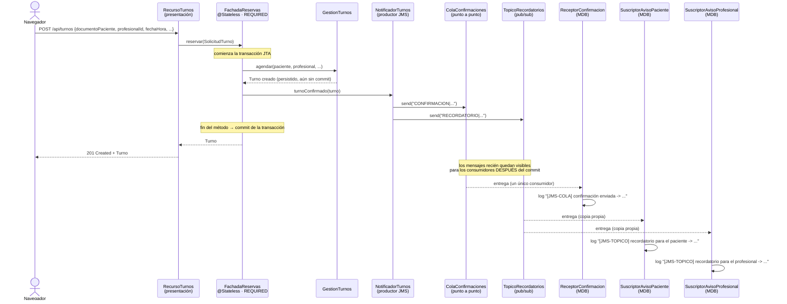
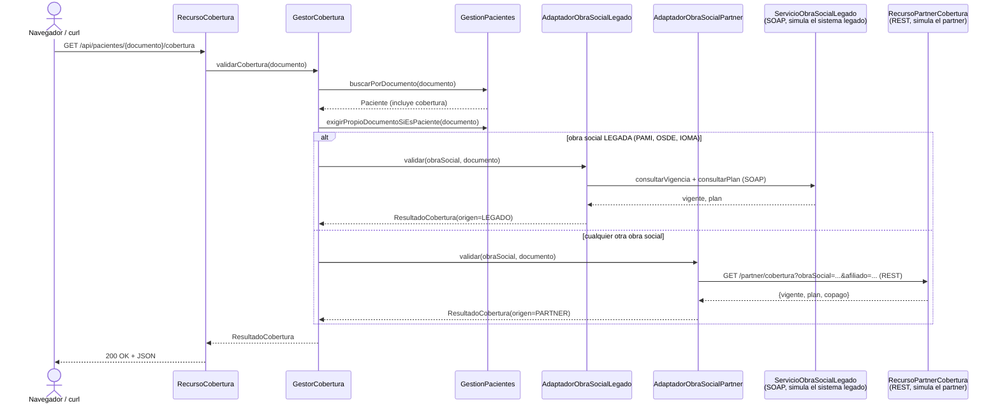

# MediConecta — Entrega Obligatoria N.º 2

**Trabajo Práctico Integrador — Desarrollo de Aplicaciones II — UADE**
**Segundo parcial**

| | |
|---|---|
| **Sistema** | MediConecta — gestión de turnos médicos |
| **Plataforma** | Jakarta EE 10 · Java 17 · Maven · WAR |
| **Contenedor** | WildFly (perfil **`standalone-full.xml`**, ver §3.5) |
| **Base de datos** | PostgreSQL |
| **Context root** | `/mediconecta` |
| **Repositorio** | <https://github.com/tobiasbonomo29/desarrollo-de-apps2> |
| **Entrega anterior** | [`Entrega_Obligatoria_1.md`](Entrega_Obligatoria_1.md) y [`arquitectura.md`](arquitectura.md) |

---

## 1. Objetivo de la entrega

La Entrega 1 dejó MediConecta funcionando de punta a punta con cuatro componentes EJB,
arquitectura en capas, persistencia JPA y seguridad declarativa, pero con dos piezas
explícitamente pendientes: mensajería asincrónica e integración con sistemas externos. Esta
entrega cierra esas dos piezas y agrega la tercera que pide la consigna: un flujo crítico con
transacción declarativa explícita.

En concreto, esta entrega agrega y demuestra:

1. **Dos procesos asincrónicos reales**, uno con una **cola punto a punto** y otro con un
   **tópico de publicación/suscripción**, ambos disparados por el mismo hecho de negocio
   (un turno confirmado).
2. **Un servicio SOAP con su WSDL**, para integrar un sistema externo legado (simulado
   dentro del propio WAR para poder demostrarlo sin depender de infraestructura ajena).
3. **Un servicio REST para un partner moderno**, consumido como cliente REST.
4. El patrón **Adapter** sobre los dos puntos anteriores: una interfaz única
   (`ValidadorCobertura`) y un componente (`GestorCobertura`) que elige a cuál de los dos
   sistemas llamar sin que quien lo consume lo sepa.
5. **Transacciones declarativas** hechas explícitas sobre el flujo crítico de reserva, que
   ahora encadena resolución de paciente, resolución de profesional, alta del turno y aviso
   por JMS como una única unidad atómica.

Lo que queda fuera de esta entrega —y por qué— está en la §8.

---

## 2. Qué cambia respecto de la Entrega 1

| Pieza nueva | Dónde vive | Reemplaza/extiende |
|---|---|---|
| `DestinosJms` | `com.mediconecta.mensajeria` | — (nuevo) |
| `NotificadorTurnos` (productor JMS) | `com.mediconecta.mensajeria` | — (nuevo) |
| `ReceptorConfirmacion` (MDB, cola) | `com.mediconecta.mensajeria` | — (nuevo) |
| `SuscriptorAvisoPaciente` / `SuscriptorAvisoProfesional` (MDB, tópico) | `com.mediconecta.mensajeria` | — (nuevo) |
| `ServicioObraSocialLegado` + `...Impl` (SOAP + WSDL) | `com.mediconecta.integraciones.simulacion` | — (nuevo) |
| `RecursoPartnerCobertura` + `AplicacionPartner` (REST) | `com.mediconecta.integraciones.simulacion` | — (nuevo) |
| `ValidadorCobertura`, `ResultadoCobertura` | `com.mediconecta.integraciones` | — (nuevo) |
| `AdaptadorObraSocialLegado` (cliente SOAP) | `com.mediconecta.integraciones` | — (nuevo) |
| `AdaptadorObraSocialPartner` (cliente REST) | `com.mediconecta.integraciones` | — (nuevo) |
| `GestorCobertura` (Adapter, elige el sistema) | `com.mediconecta.integraciones` | — (nuevo) |
| `RecursoCobertura` | `com.mediconecta.presentacion` | — (nuevo), `GET /api/pacientes/{documento}/cobertura` |
| `IntegracionExternaException` + `ManejadorIntegracionExterna` | `com.mediconecta.negocio` / `presentacion` | — (nuevo), mapea a `502` |
| `FachadaReservas.reservar()` | `com.mediconecta.negocio` | Ahora llama a `NotificadorTurnos` y declara `@TransactionAttribute(REQUIRED)` explícito |

Ningún componente de la Entrega 1 se modificó en su comportamiento observable: `reservar()`
sigue devolviendo el mismo `Turno`, con el mismo contrato JSON. Lo único que cambia es que,
dentro de la misma transacción, ahora también se envían los dos mensajes JMS.

---

## 3. Mensajería asincrónica (JMS)

### 3.1 Por qué una cola y por qué un tópico

La consigna pide un proceso con cola punto a punto y otro con tópico de
publicación/suscripción. MediConecta tiene un único hecho de negocio que naturalmente separa
en dos necesidades distintas:

- **Confirmación del turno** (cola `ColaConfirmaciones`): hay que disparar el mail o el SMS
  de confirmación al paciente **una sola vez**. Si hubiera diez instancias del componente que
  procesa confirmaciones, da igual: la cola garantiza que cada mensaje lo toma un único
  consumidor. Es el caso de libro de una cola punto a punto.
- **Recordatorio** (tópico `TopicoRecordatorios`): el mismo hecho — "este turno se confirmó"
  — le interesa a más de un interesado de forma independiente: el lado del paciente (avisarle
  más adelante) y el lado del profesional (reflejarlo en su agenda). Ninguno de los dos se
  "roba" el mensaje del otro: ambos reciben su propia copia. Es el caso de libro de un tópico
  de publicación/suscripción.

### 3.2 Diseño

```
DestinosJms                    declara los dos destinos con @JMSDestinationDefinition
NotificadorTurnos (productor)  un solo método, turnoConfirmado(Turno), envía a los dos
ReceptorConfirmacion   (MDB)   consumidor único de la cola
SuscriptorAvisoPaciente        (MDB)   un suscriptor del tópico
SuscriptorAvisoProfesional     (MDB)   el otro suscriptor del tópico
```

`DestinosJms` usa `@JMSDestinationDefinition` en lugar de crear los destinos a mano con el
CLI de WildFly (como se hizo con el datasource en la Entrega 1): es la forma portable de
Jakarta EE, el contenedor los crea solo al desplegar el WAR. El costo es que el subsistema de
mensajería tiene que estar activo en el servidor (§3.5).

`NotificadorTurnos` inyecta un `JMSContext` apuntando explícitamente a la connection factory
XA de WildFly (`java:/JmsXA`, no la no transaccional) para que el envío quede **enlistado en
la transacción JTA en curso**. Esto es la base de la demostración de transacciones
declarativas de la §5: si la transacción no hace commit, los mensajes no se entregan.

Los tres `@MessageDriven` solo registran por log lo que en un sistema real dispararía un mail,
un SMS o una sincronización de agenda — simular el efecto externo (sin depender de un
proveedor de correo real) es una simplificación deliberada; lo que la cátedra evalúa es que el
mecanismo de mensajería sea real, no que haya un proveedor de mail configurado.

### 3.3 Diagrama de secuencia



El detalle importante del diagrama es la nota "los mensajes recién quedan visibles después
del commit": como el `JMSContext` participa de la transacción XA, un mensaje enviado con
`send()` no es entregable por el broker hasta que la transacción que lo envió haga commit. Si
`agendar()` lanzara una excepción de sistema después de que `turnoConfirmado()` ya mandó los
mensajes, la transacción completa (incluidos los dos envíos) se deshace y los consumidores
nunca los ven.

### 3.4 Qué pasa con la reserva guiada (`AsistenteReservaTurno`)

El asistente `@Stateful` de la Entrega 1 confirma la reserva llamando a
`FachadaReservas.reservar(...)`, el mismo método que usa el alta directa por REST. Por el
patrón Facade ya documentado en `arquitectura.md` §4.2, el aviso por JMS queda disponible para
los dos caminos sin duplicar código ni acoplar el asistente a la mensajería.

### 3.5 Requisito de despliegue

El perfil `standalone.xml` que se usó en la Entrega 1 **no incluye** el subsistema
`messaging-activemq`. Hay que levantar WildFly con:

```powershell
bin\standalone.bat -c standalone-full.xml
```

Si se despliega el WAR con el perfil anterior, el despliegue falla: el log de WildFly indica
que no puede resolver el recurso `java:/JmsXA` o el subsistema de mensajería. Esto no se pudo
verificar en este entorno de trabajo porque no hay un WildFly corriendo acá — es el primer
paso a confirmar antes de la defensa (ver §8).

---

## 4. Integración con obras sociales: patrón Adapter (SOAP legado + REST partner)

### 4.1 El problema

MediConecta necesita validar la cobertura de un paciente contra el sistema de su obra social.
Hay dos mundos distintos, tal como anticipaba `arquitectura.md` §2 para el componente 6
(`IntegracionObrasSociales`):

- Las obras sociales grandes y antiguas (PAMI, OSDE, IOMA, en esta simulación) exponen un
  **sistema legado por SOAP**.
- Las obras sociales más nuevas (Swiss Medical, Galeno, Medicus) trabajan con un
  **partner moderno por REST**.

El componente que pide la validación no debería tener que saber cuál es cuál: ese es
exactamente el problema que resuelve el patrón **Adapter**.

### 4.2 Cómo se resuelve

```
ValidadorCobertura            interfaz única: validar(obraSocial, numeroAfiliado) → ResultadoCobertura
├── AdaptadorObraSocialLegado     habla SOAP con ServicioObraSocialLegado
└── AdaptadorObraSocialPartner    habla REST con RecursoPartnerCobertura

GestorCobertura   decide cuál adapter usar según la obra social del paciente
                  (PAMI/OSDE/IOMA → legado; cualquier otra → partner)
```

`GestorCobertura.validarCobertura(documento)` es el único punto de entrada: busca al
paciente, aplica la misma comprobación de ownership que ya usa el resto de la API
(`GestionPacientes.exigirPropioDocumentoSiEsPaciente`, documentada en `arquitectura.md`
§5.4) y delega en el adapter que corresponda. Quien llama — `RecursoCobertura`, el nuevo
endpoint `GET /api/pacientes/{documento}/cobertura` — no distingue un caso del otro.

### 4.3 El "sistema legado" simulado (SOAP + WSDL)

`ServicioObraSocialLegadoImpl` es un EJB `@Stateless` anotado `@WebService`. WildFly lo
publica automáticamente como servicio SOAP al desplegar el WAR, con su WSDL generado, sin
ninguna configuración adicional en `web.xml` (es la misma mecánica con la que WildFly ya
publica el EJB como invocable remoto; acá además lo expone por SOAP). La URL del WSDL queda,
por defecto del nombre del EJB:

```
http://localhost:8080/mediconecta/ServicioObraSocialLegado?wsdl
```

**Por qué el "sistema legado" vive en el mismo WAR.** En un escenario real este servicio lo
publicaría la obra social, en su propio servidor, y MediConecta solo tendría el WSDL y la URL
para generar el cliente. Para esta entrega, publicarlo dentro del propio proyecto permite
demostrar la integración de punta a punta sin depender de un sistema externo real — la
materia evalúa que sepamos integrar SOAP, no que tengamos acceso a un sistema de una obra
social de verdad. `AdaptadorObraSocialLegado` lo consume igual que consumiría cualquier WSDL
externo: con `jakarta.xml.ws.Service.create(URL, QName)` y `getPort(...)`, sin ningún atajo
que use el hecho de que está en el mismo proceso.

### 4.4 El "partner moderno" simulado (REST)

`RecursoPartnerCobertura` es un recurso JAX-RS bajo un `@ApplicationPath("/partner")`
**distinto** de `/api` y **fuera** del `security-constraint` de `web.xml`. Esto no es un
descuido: en producción este endpoint no sería parte de MediConecta, sería del partner, en su
propio dominio, con su propio esquema de autenticación (API key, OAuth) — no tendría sentido
protegerlo con la sesión FORM de MediConecta. `AdaptadorObraSocialPartner` lo consume con el
cliente REST estándar de Jakarta EE (`jakarta.ws.rs.client.Client`).

### 4.5 Diagrama de secuencia



### 4.6 Manejo de errores

Si el sistema legado o el partner no responden (o el WSDL/URL configurados no son los
correctos), los adapters lanzan `IntegracionExternaException`, una excepción nueva — distinta
de `ReglaNegocioException` — porque no es un resultado de negocio esperado sino una falla de
infraestructura externa. `ManejadorIntegracionExterna` la traduce a `502 Bad Gateway`, para
que un cliente HTTP pueda distinguir "tu pedido está mal" (`400`, `ReglaNegocioException`) de
"el sistema externo del que dependemos falló" (`502`).

---

## 5. Transacciones declarativas en el flujo crítico

`FachadaReservas.reservar(SolicitudTurno)` ya era, desde la Entrega 1, el único punto de
entrada al caso de uso "reservar un turno" (patrón Facade, `arquitectura.md` §4.2). Con esta
entrega pasa a encadenar cuatro pasos que tienen que confirmarse o deshacerse **todos
juntos**:

1. resolver (o dar de alta) el paciente,
2. comprobar ownership si quien llama es PACIENTE,
3. resolver el profesional,
4. agendar el turno **y** avisar por JMS.

Antes de esta entrega, el método ya corría en una transacción JTA por omisión (`REQUIRED` es
el valor por defecto de cualquier método de negocio de un EJB `@Stateless`). Lo que se agrega
ahora es hacerlo **explícito** con `@TransactionAttribute(TransactionAttributeType.REQUIRED)`,
porque:

- es el flujo que la consigna pide poder señalar como "transacción declarativa sobre un flujo
  crítico de varios pasos", y dejarlo implícito obliga a explicarlo de memoria en la defensa;
- ahora el método no solo escribe en PostgreSQL: también envía mensajes JMS, así que vale la
  pena dejar constancia en el código de que ambas cosas están atadas a la misma transacción.

**Qué significa en la práctica.** Si `gestionTurnos.agendar(...)` persiste el turno pero
después, por ejemplo, el envío a la cola lanzara una excepción de sistema (no una
`ReglaNegocioException`, que por diseño no hace rollback — ver `ReglaNegocioException`,
`arquitectura.md` §6.2), el contenedor marca la transacción para rollback y el `INSERT` del
turno **no llega a confirmarse** en la base, aunque ya se había ejecutado. Es la demostración
concreta de que "varios pasos, una sola unidad atómica" no es una frase de PowerPoint: se
puede forzar el escenario apagando el broker de mensajería con la aplicación corriendo y
mostrando que, al intentar reservar, no queda ni el turno ni los mensajes — y que vuelve a
funcionar apenas el broker está disponible de nuevo.

---

## 6. Demostración de un flujo completo (de punta a punta)

Pasos para mostrar en la defensa, con `curl` (reemplazar usuario/contraseña por los de
`README.md`, sección "Usuarios de demostración"; requiere sesión autenticada por FORM, igual
que el resto de la API):

```bash
# 1) Reservar un turno: dispara la transacción con el alta + los dos mensajes JMS
curl -s -X POST http://localhost:8080/mediconecta/api/turnos \
  -H "Content-Type: application/json" \
  -b cookies.txt \
  -d '{"documentoPaciente":"30111222","profesionalId":1,
       "especialidad":"Cardiologia","fechaHora":"2026-11-20T10:00","motivo":"Control"}'

# 2) Mirar la consola de WildFly: deberían aparecer, en este orden,
#    [JMS-COLA] confirmacion enviada -> ...
#    [JMS-TOPICO] recordatorio para el paciente -> ...
#    [JMS-TOPICO] recordatorio para el profesional -> ...

# 3) Validar cobertura de un paciente con obra social "legada" (va por SOAP)
curl -s -b cookies.txt \
  http://localhost:8080/mediconecta/api/pacientes/30111222/cobertura
# -> {"vigente":true,"plan":"OSDE 210","copago":0.0,"origen":"LEGADO"}

# 4) Validar cobertura de un paciente con obra social "moderna" (va por REST)
curl -s -b cookies.txt \
  http://localhost:8080/mediconecta/api/pacientes/30333444/cobertura
# -> {"vigente":true,"plan":"SMG20","copago":3500.0,"origen":"PARTNER"}

# 5) (opcional) Ver el WSDL publicado del sistema legado
curl -s http://localhost:8080/mediconecta/ServicioObraSocialLegado?wsdl

# 6) (opcional) Llamar directamente a la API simulada del partner, sin pasar por MediConecta
curl -s "http://localhost:8080/mediconecta/partner/cobertura?obraSocial=GALENO&afiliado=123"
```

El paso 2 es el que conecta visualmente los tres componentes involucrados (REST de entrada →
Facade con transacción → JMS con sus tres consumidores) y el que mejor responde a "demostración
de un flujo completo que conecte los componentes involucrados" de la consigna.

---

## 7. Simplificaciones deliberadas y por qué

| Simplificación | Por qué se aceptó |
|---|---|
| El sistema legado SOAP y el partner REST viven en el mismo WAR que MediConecta | Permite demostrar la integración real (SOAP+WSDL, cliente REST) sin depender de infraestructura externa real. Los adapters los consumen exactamente igual que si estuvieran afuera: por URL/WSDL configurable, no por una llamada directa a la clase. |
| Las "bases de afiliados" del legado y del partner son tablas fijas en memoria (`Map.of(...)`) | Lo que se evalúa es el protocolo de integración, no un padrón de afiliados real. |
| El partner REST no exige autenticación | Representa que, en producción, el esquema de autenticación lo definiría el partner (API key, OAuth), no MediConecta; agregar uno de mentira no sumaría nada a la demostración. |
| Las notificaciones JMS solo escriben un log | Evita acoplar la entrega a un proveedor de mail/SMS real. El mecanismo de mensajería (cola, tópico, transacción) es real; el efecto final (enviar el mail) se simula, igual que ya se simulaba el envío de confirmaciones antes de esta entrega. |
| No hay suscripciones durables en el tópico | Alcanza con que ambos MDB reciban su copia mientras la aplicación está desplegada, que es lo que hay que demostrar; una suscripción durable (para no perder mensajes con la app caída) es una optimización de producción fuera del alcance de esta entrega. |

---

## 8. Qué queda pendiente

- **Verificar el despliegue real.** Todo lo de esta entrega se escribió y se compiló
  (`mvn clean package`, `BUILD SUCCESS`) pero no se pudo desplegar ni probar contra un WildFly
  en este entorno de trabajo. Antes de la defensa falta: confirmar que WildFly arranca con
  `standalone-full.xml`, confirmar la URL exacta en la que queda publicado el WSDL del sistema
  legado (puede variar según la versión de WildFly) y correr el flujo completo de la §6.
- **Pruebas automatizadas** de los nuevos flujos (mensajería e integración), análogas a las
  que ya existen para ownership y archivado.
- **Trello.** Queda explícitamente fuera de esta actualización — no se tocó el tablero real;
  sigue pendiente lo que ya se detalla en `docs/trello-actualizaciones.md`.
- **Casos de uso y manual de usuario**, cubiertos en documentos separados:
  [`docs/casos-de-uso.md`](casos-de-uso.md) y [`docs/manual-usuario.md`](manual-usuario.md).
