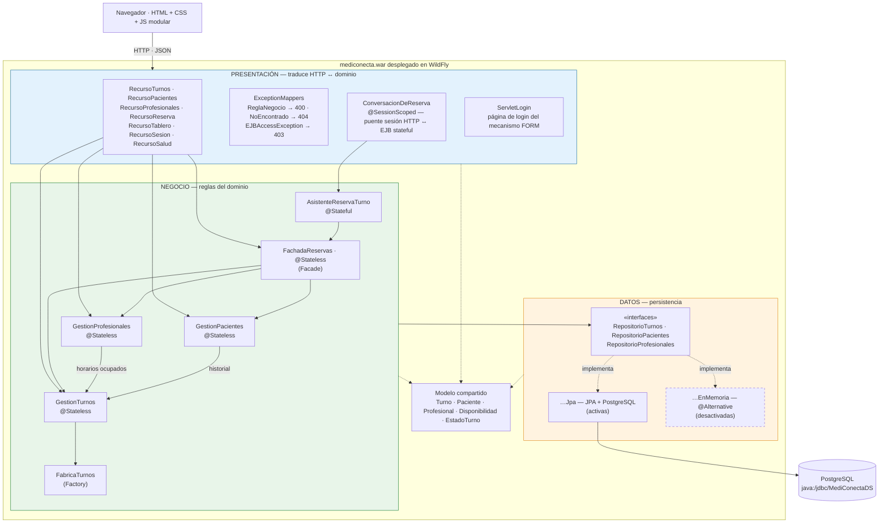
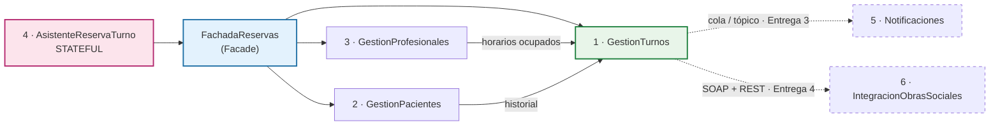
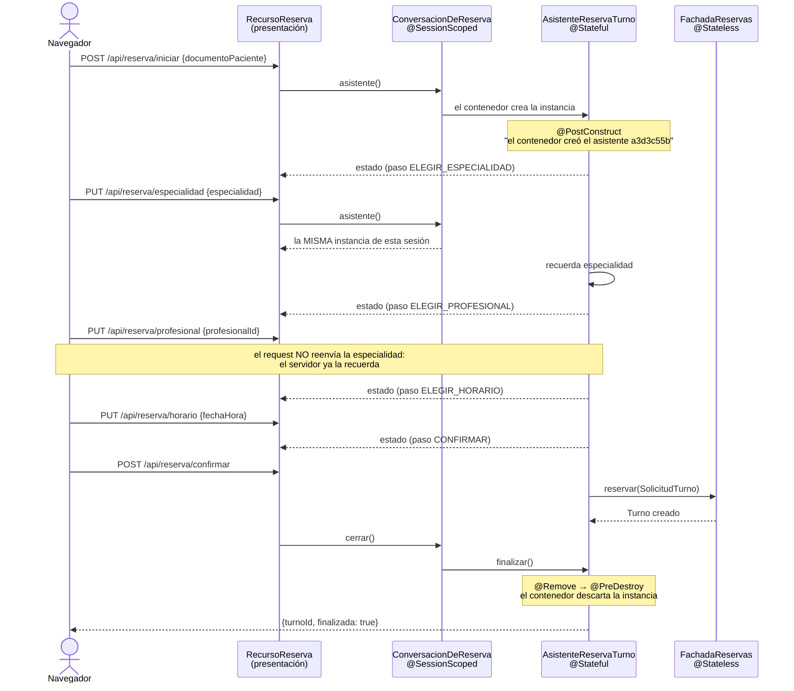
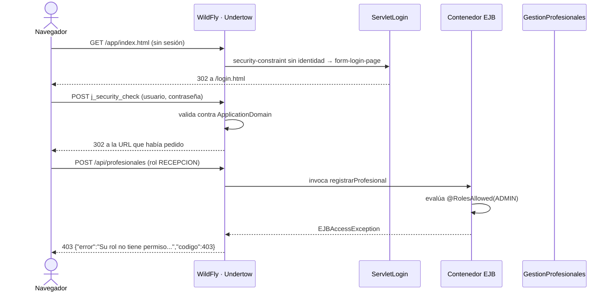
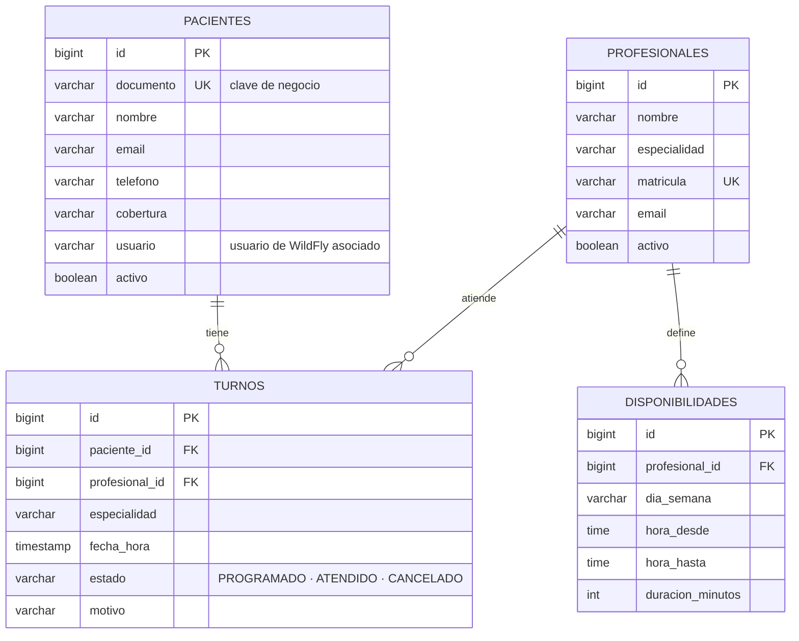

# Documento de arquitectura — MediConecta

**Materia:** Desarrollo de Aplicaciones II — UADE
**Dominio:** MediConecta — gestión de turnos médicos, pacientes y profesionales
**Alcance:** arquitectura de la Entrega Obligatoria N.º 1 (cuatro componentes implementados)

---

## 1. Arquitectura en capas

El sistema se organiza en tres capas con una regla estricta: **cada capa sólo conoce a la
que está debajo**, nunca al revés. Presentación depende de negocio, negocio depende de
datos, y datos no depende de nadie.



### 1.1 Presentación — `com.mediconecta.presentacion`

**Responsabilidad:** hablar con el mundo exterior. Recibe pedidos HTTP, los traduce al
lenguaje del negocio, delega, y convierte la respuesta (o el error) en HTTP + JSON.

- `AplicacionRest` activa JAX-RS y fija el prefijo `/api`.
- Los recursos (`RecursoTurnos`, `RecursoPacientes`, `RecursoProfesionales`,
  `RecursoReserva`, `RecursoTablero`, `RecursoSesion`, `RecursoSalud`) son fachadas
  delgadas: ninguno tiene un `if` de negocio.
- Los `ExceptionMapper` traducen las excepciones del dominio a códigos HTTP.
- `ConversacionDeReserva` es el bean CDI `@SessionScoped` que ata el EJB `@Stateful` a la
  sesión HTTP. Vive acá y no en negocio porque el alcance de sesión es un concepto web.
- `ServletLogin` es la página de login del mecanismo FORM del contenedor.
- `PedidoTurno` y `PasoReserva` son DTO de entrada: acomodan nombres de campos, no deciden
  nada.

**Qué NO hace, a propósito:** no valida reglas del dominio, no ordena resultados, no toca
el almacenamiento y no decide quién puede hacer qué.

### 1.2 Negocio — `com.mediconecta.negocio`

**Responsabilidad:** ser el único lugar donde viven las reglas del dominio y las decisiones
de autorización.

Cuando una regla no se cumple lanza una excepción propia (`ReglaNegocioException`,
`NoEncontradoException`) que **no menciona HTTP**. Eso es lo que permitirá exponer el mismo
negocio por SOAP o consumirlo desde una cola en las próximas entregas sin tocarlo.

Las anotaciones `@RolesAllowed` están acá, sobre los métodos de negocio, y no en los
recursos REST: así la restricción vale para cualquier forma de invocación.

### 1.3 Datos — `com.mediconecta.datos`

**Responsabilidad:** guardar y recuperar. Tres interfaces escritas en términos del dominio
(`RepositorioTurnos`, `RepositorioPacientes`, `RepositorioProfesionales`) y dos juegos de
implementaciones: `datos.jpa` (activo, sobre PostgreSQL) y `datos.memoria`
(`@Alternative`, desactivado).

Es la única capa que conoce `EntityManager`. No abre ni cierra transacciones: el
`EntityManager` es *transaction-scoped* y se engancha a la transacción JTA que el contenedor
abrió al entrar al método del EJB que lo llamó.

### 1.4 Modelo — `com.mediconecta.modelo`

`Turno`, `Paciente`, `Profesional`, `Disponibilidad` y `EstadoTurno` son entidades JPA sin
lógica de negocio. No forman una capa: son el vocabulario común que atraviesa las tres.

Las relaciones son **unidireccionales** (el turno conoce al paciente y al profesional, no al
revés), lo que mantiene el JSON libre de ciclos sin necesidad de DTO de salida.

---

## 2. Los seis componentes de MediConecta

| # | Componente | Responsabilidad | Tipo | Entrega |
|---|---|---|---|---|
| 1 | **GestionTurnos** | Reglas de la agenda: alta, consulta y cancelación | Stateless | **1 · implementado** |
| 2 | **GestionPacientes** | Padrón de pacientes e historial de atenciones | Stateless | **1 · implementado** |
| 3 | **GestionProfesionales** | Profesionales, especialidades, disponibilidad y horarios libres | Stateless | **1 · implementado** |
| 4 | **AsistenteReservaTurno** | Reserva guiada en cuatro pasos | **Stateful** | **1 · implementado** |
| 5 | **Notificaciones** | Avisos de confirmación y recordatorio al paciente | Stateless + asincrónico (cola y tópico) | 3 |
| 6 | **IntegracionObrasSociales** | Validación de cobertura contra un sistema legado (SOAP) y un partner moderno (REST) | Stateless (patrón Adapter) | 4 |



`GestionTurnos` está en el centro del sistema: es el componente sobre el que se apoyan
todos los demás, y por eso fue el primero en implementarse.

---

## 3. Stateless y stateful

### 3.1 El criterio

Un componente es **stateless** cuando no conserva estado de conversación con un cliente
entre una invocación y la siguiente. Es **stateful** cuando sí lo hace, porque una
operación del negocio se desarrolla a lo largo de varias llamadas y el servidor tiene que
recordar lo que *ese* cliente en particular fue eligiendo.

### 3.2 Por qué `GestionTurnos`, `GestionPacientes` y `GestionProfesionales` son stateless

Cada uno de sus métodos recibe en sus parámetros todo lo que necesita, resuelve y termina.
No hay ningún campo de instancia que guarde resultados entre llamadas: los únicos atributos
son referencias inyectadas a colaboradores, que son colaboración y no estado del cliente.
En consecuencia:

- el orden de las llamadas no cambia el resultado;
- dos requests del mismo usuario pueden ser atendidos por **instancias distintas** del pool
  sin ninguna diferencia observable;
- no hace falta ningún identificador de sesión.

**Qué ganamos:** el contenedor mantiene un pool acotado de instancias y las reutiliza entre
clientes, en lugar de dedicar una por cliente y tener que replicarla en cluster como haría
con un `@Stateful`.

**La objeción esperable, respondida.** "Pero los turnos se guardan en algún lado, ¿eso no es
estado?". Sí, pero es **estado de aplicación**: vive en la base de datos, detrás de la capa
de datos, y es compartido por todos los clientes. Lo que define a un componente como
stateless es que no conserve estado *de conversación con un cliente particular*.

### 3.3 Por qué `AsistenteReservaTurno` es stateful

Reservar un turno guiado es **una sola operación de negocio repartida en cuatro
invocaciones**: elegir especialidad, elegir profesional, elegir horario y confirmar. Entre
una y otra el servidor tiene que recordar lo que ese usuario fue eligiendo.

La prueba concreta está en el contrato de la API: `PUT /api/reserva/profesional` recibe
**únicamente** `{"profesionalId": 1}`. No lleva el paciente ni la especialidad, y sin
embargo el servidor los conoce. El navegador solo manda la cookie `JSESSIONID`.

```java
@Stateful
@StatefulTimeout(value = 30, unit = TimeUnit.MINUTES)
public class AsistenteReservaTurno implements Serializable {

    private String documentoPaciente;   // estado de conversación:
    private String especialidad;        // sobrevive entre llamadas
    private Long   profesionalId;       // y es propio de ESTE cliente
    private LocalDateTime fechaHora;
    private int paso;
    ...
}
```

El contraste con `GestionTurnos` es la mejor forma de defender la decisión: el asistente
tiene campos que representan una conversación en curso; `GestionTurnos` no tiene ninguno.

### 3.4 Cómo se ata la conversación a la sesión HTTP

Un EJB stateful no se asocia solo a una sesión web: hay que guardar su referencia en algo
que viva lo mismo que la sesión HTTP. Eso es `ConversacionDeReserva`, un bean CDI
`@SessionScoped` que CDI asocia a la cookie `JSESSIONID`.



Se inyecta `Instance<AsistenteReservaTurno>` y no el EJB directamente porque hace falta
poder **destruir** la instancia al terminar la conversación y pedir una nueva para la
siguiente reserva.

### 3.5 Ciclo de vida administrado por el contenedor

Durante la demostración, el log del servidor muestra las tres marcas:

```
[STATEFUL] @PostConstruct - el contenedor creo el asistente f851323c (instancia 136b1919)
[STATEFUL] conversacion f851323c recuerda especialidad=Cardiologia
[STATEFUL] conversacion f851323c recuerda profesional=Dra. Laura Fernandez
[STATEFUL] conversacion f851323c confirmada: turno 16
[STATEFUL] @Remove - fin de la conversacion f851323c en el paso 5
[STATEFUL] @PreDestroy - el contenedor descarta el asistente f851323c (instancia 136b1919)
[STATEFUL] @PostConstruct - el contenedor creo el asistente a3d3c55b (instancia 6cb82941)
```

| Anotación | Quién la invoca | Cuándo | Para qué sirve acá |
|---|---|---|---|
| `@PostConstruct` | el contenedor | después de crear la instancia e inyectar sus dependencias | abre la conversación y le asigna identificador |
| `@Remove` | la aplicación, al terminar | cuando se confirma o se abandona la reserva | le avisa al contenedor que puede descartar el bean |
| `@PreDestroy` | el contenedor | justo antes de descartar la instancia | deja registro del cierre en el log |
| `@StatefulTimeout` | el contenedor | si el usuario abandona a mitad de camino | libera la instancia a los 30 minutos sin actividad |

El identificador de instancia (`136b1919`) es el `identityHashCode` del objeto: se muestra
en la pantalla de reserva y sirve para probar en vivo que, entre paso y paso, es **el mismo
objeto en el servidor**, y que después de confirmar es **otro distinto**.

---

## 4. Patrones de diseño

### 4.1 DAO / Repository

**Dónde:** `com.mediconecta.datos` — las interfaces `RepositorioTurnos`,
`RepositorioPacientes` y `RepositorioProfesionales`, con implementaciones en `datos.jpa` y
`datos.memoria`.

**Qué problema resuelve.** La primera versión del sistema guardaba los turnos en un
`ConcurrentHashMap`. Esta entrega exige migrar a JPA + PostgreSQL. Si la capa de negocio
hubiera hablado directamente con el `Map` (o ahora con `EntityManager`), cambiar de
almacenamiento obligaría a reescribir las reglas del dominio, que es precisamente el código
que no debería tocarse por un motivo de infraestructura.

**Cómo lo resuelve.** El negocio inyecta la **interfaz**, nunca la implementación. La
interfaz está escrita en el lenguaje del dominio: `existeTurnoVigente(profesionalId,
fechaHora)` en lugar de `select count(*) from ...`.

**La prueba de que funciona.** La migración de memoria a PostgreSQL se hizo escribiendo tres
clases nuevas en `datos.jpa`. `GestionTurnos`, `GestionPacientes`, `GestionProfesionales` y
toda la capa de presentación quedaron **sin un solo cambio** relacionado con la
persistencia. Las implementaciones en memoria siguen en el repositorio, anotadas
`@Alternative`, y se pueden reactivar descomentando tres líneas de `beans.xml`.

**Por qué se eligió.** Porque el enunciado obliga a cambiar de almacenamiento entre
entregas, y porque la interfaz es lo que hace posible tener las dos implementaciones
conviviendo.

**Alternativa descartada.** Que cada componente de negocio recibiera el `EntityManager` y
escribiera sus propias consultas JPQL. Es menos código al principio, pero mezcla reglas de
negocio con detalles de persistencia, hace imposible el plan B sin base de datos y obliga a
tocar el negocio cada vez que cambia una consulta.

### 4.2 Facade

**Dónde:** `com.mediconecta.negocio.FachadaReservas`.

**Qué problema resuelve.** Reservar un turno no es una operación de un solo componente. Hay
que resolver el paciente (o darlo de alta si es la primera vez), resolver el profesional,
verificar que la especialidad sea coherente y recién entonces agendar. Si esa coreografía
viviera en `RecursoTurnos`, la capa de presentación tendría que inyectar y ordenar tres
componentes de negocio. Y como el asistente stateful hace exactamente lo mismo al
confirmar, la secuencia quedaría **duplicada en dos lugares** que se irían
desincronizando: el día que se agregue un paso —por ejemplo validar la cobertura contra la
obra social en la Entrega 4— habría que acordarse de agregarlo en los dos.

**Cómo lo resuelve.** La fachada concentra la coordinación. Sus dos clientes —el alta
directa por REST y el asistente `@Stateful`— llaman a `reservar(SolicitudTurno)` y no saben
cuántos componentes hay detrás. La misma idea aplica a `resumenDelDia()`: la pantalla de
inicio se resuelve con **una** llamada en lugar de cuatro.

**El límite que se respetó.** La fachada **coordina pero no decide**. Cada regla la sigue
aplicando su dueño: `GestionPacientes` valida el padrón, `GestionTurnos` valida fecha futura
y superposición, `FabricaTurnos` valida la coherencia de la especialidad. Esa es la
diferencia entre un Facade y un componente que termina siendo el cajón de sastre del
sistema.

**Por qué se eligió.** Porque hay dos clientes distintos para el mismo caso de uso. Con uno
solo habría sido discutible; con dos, no tenerlo garantizaría la duplicación.

**Alternativa descartada.** Que `GestionTurnos` buscara por su cuenta el paciente y el
profesional. Parece más simple, pero convierte al componente central del sistema en
dependiente de los otros dos, genera un grafo de dependencias circular en cuanto
`GestionPacientes` necesita consultar turnos, y mezcla "reglas del turno" con "coordinación
del caso de uso".

### 4.3 Factory

**Dónde:** `com.mediconecta.negocio.FabricaTurnos`.

**Qué problema resuelve.** Un `Turno` no queda bien formado con `new Turno()`. Hay que
fijarle el estado inicial `PROGRAMADO` (y no dejar que lo elija el cliente HTTP, porque si
no cualquiera podría crear por API un turno que nace ya como `ATENDIDO`), llevar la fecha al
formato canónico truncado al minuto, y completar la especialidad a partir del profesional
verificando que sean coherentes.

Ese truncado no es un detalle estético: la regla de superposición compara el momento del
turno contra los turnos vigentes del profesional. Si un camino de creación dejara los
segundos, `09:30:00` y `09:30:59` serían instantes distintos para la comparación y el
sistema dejaría de detectar la superposición. **Este defecto ya existió en la versión
anterior del proyecto**, cuando la fecha era texto y dos cadenas distintas representaban el
mismo momento.

Hoy hay **tres caminos** que crean turnos: el alta directa por REST, el asistente stateful
y la carga de datos de ejemplo. Si cada uno armara el objeto a mano, alcanzaría con que uno
se olvidara de una invariante para que la regla dejara de funcionar, y el bug no se vería
hasta la demostración.

**Cómo lo resuelve.** Los tres caminos pasan por `FabricaTurnos.crear(...)`. La invariante
"todo turno nace PROGRAMADO, con fecha truncada al minuto y con especialidad coherente con
su profesional" queda garantizada por construcción, en un único método.

**Por qué se eligió.** Porque concentra una invariante que ya se había roto una vez y que
hoy tiene tres puntos de entrada. Un Factory que solo hiciera `new` sería decorativo; éste
impide un bug concreto y documentado.

**Alternativa descartada.** Un constructor con muchos parámetros en `Turno`. No evita que
alguien use el constructor vacío (que JPA necesita que exista), y pondría lógica de validación
dentro de una entidad que queremos que siga siendo un objeto de datos.

**Por qué no Adapter todavía.** Adapter es el patrón natural para la Entrega 4, donde hay
que hablar con una obra social por SOAP y con otra por REST detrás de una misma interfaz.
Implementarlo ahora, sin ningún sistema externo del otro lado, sería crear una clase vacía
para poder decir que el patrón existe.

---

## 5. Seguridad

### 5.1 Mecanismo

Autenticación **FORM administrada por el contenedor**. El formulario de `login.html` hace
POST a `j_security_check` con los campos `j_username` y `j_password`; **MediConecta nunca ve
la contraseña**. Quien las valida es WildFly contra el dominio de seguridad
`ApplicationDomain`, respaldado por `application-users.properties` y
`application-roles.properties`.

No hay una sola línea de código Java que compare contraseñas ni que decida qué rol puede
hacer qué: todo está declarado.



### 5.2 Las dos mitades

| | Qué declara | Dónde | Qué protege |
|---|---|---|---|
| **Autenticación** | *quién sos* | `web.xml`: `<login-config>` FORM + `<security-constraint>` sobre `/api/*` y `/app/*` | que exista una identidad válida |
| **Autorización** | *qué podés hacer* | `@RolesAllowed` sobre los métodos de negocio | cada operación concreta |

La autorización está en la **capa de negocio** a propósito. Si estuviera en los recursos
REST, valdría solo para HTTP; puesta sobre el EJB, el contenedor la aplica también cuando
el método se invoque desde el asistente stateful, desde un consumidor de mensajería o desde
un servicio SOAP.

### 5.3 Matriz de permisos

| Operación | PACIENTE | RECEPCION | MEDICO | ADMIN |
|---|:--:|:--:|:--:|:--:|
| Prueba de vida (`/api/salud`) | público | público | público | público |
| Ver la agenda completa | — | ✔ | ✔ | ✔ |
| Ver un turno puntual | ✔ | ✔ | ✔ | ✔ |
| Agendar un turno directo | solo para sí mismo | ✔ | — | ✔ |
| Cancelar un turno | solo el propio | ✔ | solo de su agenda | ✔ |
| **Archivar un turno cancelado** | — | ✔ | — | ✔ |
| Listar el padrón de pacientes | — | ✔ | ✔ | ✔ |
| Registrar un paciente | ✔ | ✔ | — | ✔ |
| Modificar datos de un paciente | — | ✔ | — | ✔ |
| Ver historial de un paciente | solo el propio | ✔ | ✔ | ✔ |
| Listar profesionales y horarios libres | ✔ | ✔ | ✔ | ✔ |
| **Registrar un profesional** | — | — | — | ✔ |
| **Definir disponibilidad** | — | ✔ (de cualquiera) | solo la propia | ✔ (de cualquiera) |
| Ver la propia ficha de profesional (`mi-perfil`) | — | — | ✔ | — |
| Tablero de la clínica | — | ✔ | ✔ | ✔ |
| Reserva guiada | ✔ (para sí mismo) | ✔ | — | ✔ |

### 5.4 Un caso donde lo declarativo no alcanza

`GET /api/pacientes/{documento}/turnos` está permitido para los cuatro roles, porque un
paciente tiene que poder ver su historial. Pero "los cuatro roles" no distingue *qué*
historial: sin más, cualquier paciente podría leer el de otro cambiando el documento de la
URL.

Por eso `GestionPacientes.historialDeTurnos` combina las dos formas de autorización: la
declarativa deja pasar al método, y una comprobación **programática** con
`SessionContext.getCallerPrincipal()` verifica que, si el llamador solo tiene rol PACIENTE,
el documento pedido sea el de su propia ficha. La asociación entre el usuario de WildFly y
la ficha está en la columna `usuario` de la tabla `pacientes`.

### 5.5 Por qué FORM y no BASIC

FORM permite usar la pantalla de login del prototipo de Figma, mientras que BASIC obliga al
diálogo nativo del navegador, que no se puede maquetar. El costo de FORM es que, ante una
petición sin sesión, el contenedor responde con la página de login en lugar de un `401`, lo
que confundiría a un cliente JSON.

Se resolvió sin salirse del estándar: `<form-login-page>` no apunta a un HTML sino al
servlet `ServletLogin`, que mira la petición y responde distinto según quién pregunte. Si
el cliente pidió JSON (nuestro `fetch` envía `X-Requested-With`, y `curl` envía
`Accept: application/json`) devuelve **401** con el mismo formato de error que el resto de
la API; si es un navegador navegando, redirige a la pantalla de login.

Se redirige y no se hace *forward* porque con un forward la barra del navegador seguiría
mostrando la URL protegida y las rutas relativas de `login.html` (`css/`, `js/`) se
resolverían mal.

---

## 6. Persistencia

- **Unidad de persistencia:** `mediconectaPU`, declarada en
  `src/main/resources/META-INF/persistence.xml`, con `transaction-type="JTA"`.
- **Datasource:** `java:/jdbc/MediConectaDS`, definido **en WildFly**, no en el WAR. Por eso
  el usuario y la contraseña de PostgreSQL no están en el código versionado.
- **Esquema:** lo genera Hibernate (`hibernate.hbm2ddl.auto=update`). El DDL equivalente
  está documentado en `scripts/db/esquema.sql`.

### 6.1 Modelo relacional



### 6.2 Dónde vive la transacción

En el EJB. Cada método público de un `@Stateless` corre en su propia transacción JTA
(`REQUIRED` por omisión): el contenedor la abre al entrar y hace *commit* al salir, o
*rollback* si escapa una excepción de sistema.

Por eso los repositorios nunca llaman a `begin()` ni a `commit()`, y por eso
`FachadaReservas.reservar()` —que puede dar de alta un paciente y después agendar un
turno— hace las dos cosas dentro de **una sola transacción**: si el alta del turno falla,
el paciente tampoco queda registrado.

Las excepciones de negocio llevan `@ApplicationException(rollback = false)` justamente para
que un resultado previsto (por ejemplo "ese horario ya está tomado") **no** marque la
transacción para rollback ni ensucie el log con un stack trace.

---

## 7. Decisiones técnicas y alternativas descartadas

### 7.1 EJB `@Stateless` en lugar de bean CDI `@ApplicationScoped`

**Decisión:** los tres componentes de negocio son EJB `@Stateless`.
**Por qué:** el contenedor agrega sin escribir código el pool de instancias, las
**transacciones declarativas** y la **seguridad declarativa** (`@RolesAllowed`), que es
justamente lo que esta entrega necesita.
**Descartado:** un bean CDI común. Obligaría a agregar `@Transactional` a mano y, sobre
todo, haría menos evidente la contraposición stateless / stateful que la materia evalúa.

### 7.2 `fechaHora` pasa de texto a `LocalDateTime`

**Decisión:** la fecha del turno es una columna `timestamp` y un `LocalDateTime` en el
modelo. En la versión anterior era texto.
**Por qué:** era la deuda declarada del documento de arquitectura anterior. Con texto, la
comparación de horarios dependía de que todos los caminos escribieran exactamente el mismo
formato.
**Cuidado que hubo que tener:** JSON-B serializa `LocalDateTime` en ISO-8601 *con*
segundos, lo que habría cambiado el contrato de la API respecto de la primera entrega. Se
anotó el campo con `@JsonbDateFormat("yyyy-MM-dd'T'HH:mm")` para que la salida JSON siga
siendo **idéntica** a la anterior.

### 7.3 La especialidad es texto y no una entidad

**Decisión:** `Profesional.especialidad` es un `String`.
**Por qué:** para lo que el sistema necesita hoy —listar, filtrar y agrupar— una tabla de
especialidades agregaría un join sin aportar ninguna regla.
**Cuándo cambiaría:** si una especialidad pasara a tener atributos propios (duración
estándar del turno, requisitos de derivación, cobertura).

### 7.4 Relaciones unidireccionales y sin DTO de salida

**Decisión:** `Turno` conoce a `Paciente` y `Profesional`, pero no al revés; las entidades
se serializan directamente a JSON.
**Por qué:** sin relaciones bidireccionales no hay ciclos, así que no hace falta una capa de
DTO de salida que habría triplicado la cantidad de clases sin aportar nada.
**Costo aceptado:** el JSON de un turno incluye la ficha completa del paciente y del
profesional. Para el volumen de este sistema no es un problema.
**Sí hay DTO de entrada** (`PedidoTurno`, `PasoReserva`), porque ahí sí aportan: permiten
aceptar el formato viejo y el nuevo de `POST /api/turnos` sin ensuciar el modelo.

### 7.5 El paquete raíz pasó de `com.mediconecta.turnos` a `com.mediconecta`

**Decisión:** el paquete raíz ya no menciona "turnos".
**Por qué:** con cuatro componentes, tener `com.mediconecta.turnos.modelo.Paciente` daba a
entender que todo el sistema es el componente de turnos. La estructura interna por capas
(`modelo`, `datos`, `negocio`, `presentacion`) no cambió.

### 7.6 Frontend sin framework

**Decisión:** HTML semántico, CSS propio y módulos ES nativos. Sin React, sin Tailwind, sin
Bootstrap, sin dependencias de Node.
**Por qué:** la materia evalúa Jakarta EE. Un framework de frontend agregaría un paso de
compilación, cientos de dependencias y una discusión que no aporta a lo que se defiende.
**Cómo se evitó el archivo gigante:** una página HTML por pantalla y un módulo JS por
pantalla, más tres módulos compartidos (`api.js`, `ui.js`, `layout.js`). La barra lateral y
la superior las dibuja `layout.js`, así que no están copiadas en ocho archivos.
**Cuidado que se tuvo:** todo dato que viene del servidor pasa por `esc()` antes de
insertarse en HTML, para que un nombre con etiquetas adentro no se interprete como marcado.

### 7.7 Context root `mediconecta` vía `<finalName>`

**Decisión:** el WAR se llama `mediconecta.war`, así que la URL base es
`http://localhost:8080/mediconecta/`.
**Por qué:** WildFly usa el nombre del archivo como context root. Fijarlo en el `pom.xml`
hace que todos los integrantes prueben exactamente la misma URL.
**Detalle:** el frontend **no** asume ese nombre. `api.js` deduce el context root de la URL
del propio módulo (`import.meta.url`), así que la aplicación sigue funcionando si el WAR se
despliega con otro nombre.

### 7.8 Dependencia única con scope `provided`

**Decisión:** sólo `jakarta.platform:jakarta.jakartaee-api:10.0.0`, en scope `provided`.
**Por qué:** las implementaciones (RESTEasy, Weld, Hibernate, el contenedor de EJB) las
aporta WildFly. Empaquetarlas dentro del WAR generaría clases duplicadas en el classpath y
el despliegue fallaría. El WAR pesa unos 120 kB, casi todo frontend.

---

## 8. Estado de cumplimiento de la entrega

| Requisito | Estado |
|---|---|
| Mínimo 3 componentes implementados | ✔ cuatro: C1, C2, C3 y C4 |
| Al menos un `@Stateless` | ✔ `GestionTurnos`, `GestionPacientes`, `GestionProfesionales`, `FachadaReservas` |
| Al menos un `@Stateful` real | ✔ `AsistenteReservaTurno`, con estado de conversación verificable |
| Arquitectura en presentación / negocio / datos | ✔ tres paquetes, dependencias en un solo sentido |
| Mínimo 3 patrones de diseño | ✔ DAO/Repository, Facade, Factory |
| Seguridad declarativa con autenticación y roles | ✔ FORM + `@RolesAllowed`, cuatro roles |
| Cancelación de turnos | ✔ `PUT /api/turnos/{id}/cancelar` |
| Persistencia JPA + PostgreSQL | ✔ `mediconectaPU` sobre `java:/jdbc/MediConectaDS` |
| Interfaz acorde al prototipo | ✔ ocho pantallas, responsive |
| WAR desplegable | ✔ `target/mediconecta.war` |
| Documentación actualizada | ✔ este documento, README y los tres documentos de defensa |
