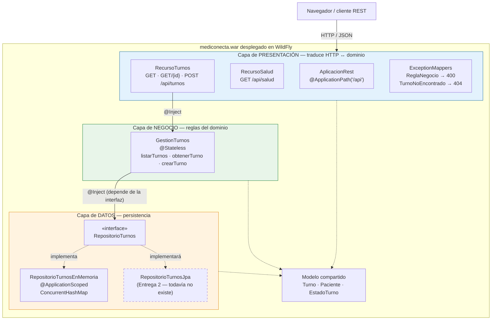
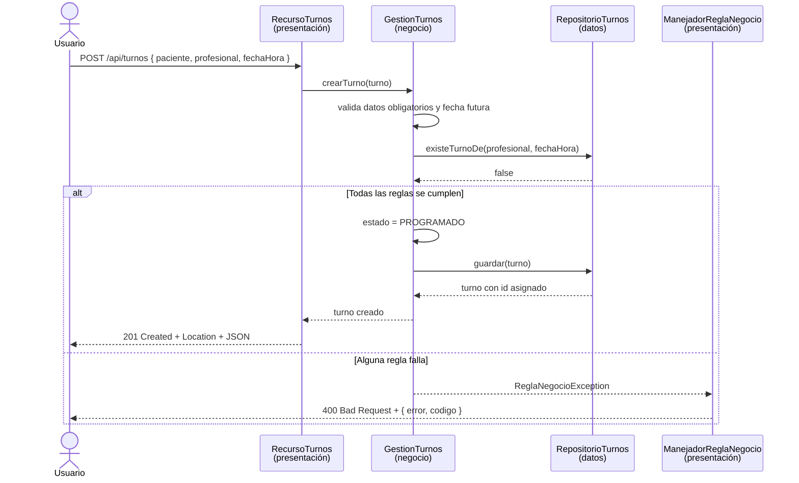
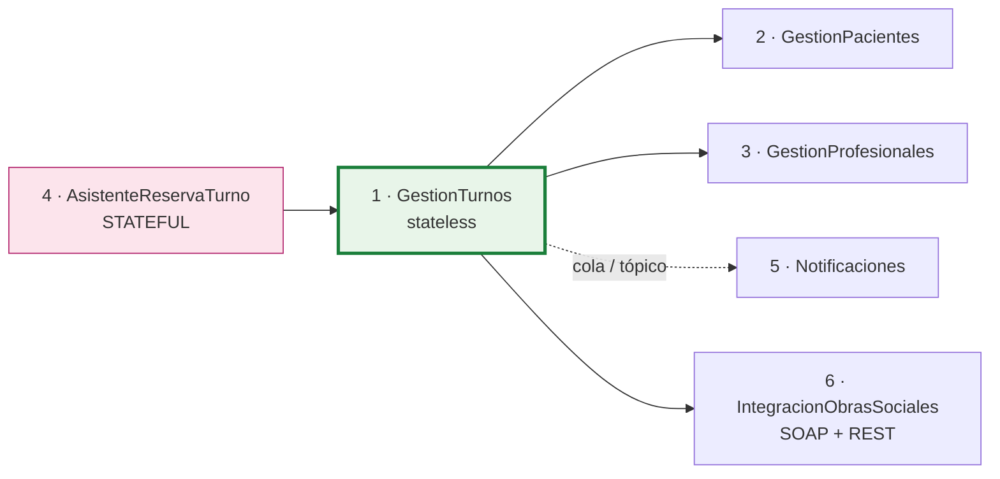

# Documento de arquitectura — MediConecta (Entrega 1)

**Materia:** Desarrollo de Aplicaciones II
**Dominio:** MediConecta — gestión de turnos médicos, pacientes y profesionales
**Alcance de este documento:** arquitectura del primer componente real, `GestionTurnos`,
y el mapa de los componentes que se van a construir en las próximas entregas.

---

## 1. Arquitectura en capas

El sistema se organiza en tres capas con una regla estricta: **cada capa sólo conoce a la que
está inmediatamente debajo**, y nunca al revés. Presentación depende de negocio, negocio
depende de datos, y datos no depende de nadie.

### 1.1 Capa de presentación — `com.mediconecta.turnos.presentacion`

**Responsabilidad:** hablar con el mundo exterior. Recibe pedidos HTTP, los traduce al
lenguaje del negocio, delega, y convierte la respuesta (o el error) en HTTP + JSON.

**Qué hace:**

- `AplicacionRest` activa JAX-RS y fija el prefijo `/api`.
- `RecursoSalud` expone la prueba de vida del contenedor.
- `RecursoTurnos` expone listar / obtener / crear turnos.
- `ManejadorReglaNegocio` y `ManejadorTurnoNoEncontrado` traducen las excepciones del
  negocio a los códigos HTTP correctos (400 y 404).

**Qué NO hace, a propósito:** no valida reglas del dominio, no ordena resultados y no toca
el almacenamiento. Si mañana se reemplaza REST por SOAP, el comportamiento del sistema es
idéntico.

### 1.2 Capa de negocio — `com.mediconecta.turnos.negocio`

**Responsabilidad:** ser el único lugar donde viven las reglas del dominio.

`GestionTurnos` (EJB `@Stateless`) decide:

- que un turno necesita paciente con nombre y documento, profesional y especialidad;
- que la fecha tiene que ser válida y **futura**;
- que un profesional no puede tener dos turnos vigentes en el mismo horario;
- que todo turno nace en estado `PROGRAMADO` (lo fija el negocio, no el cliente, para que
  nadie pueda crear por HTTP un turno que nazca ya como `ATENDIDO`);
- que la agenda se lee ordenada cronológicamente.

Cuando una regla no se cumple lanza una excepción propia (`ReglaNegocioException`,
`TurnoNoEncontradoException`) que **no menciona HTTP**. Eso es lo que permite reutilizar este
componente tal cual desde un servicio SOAP o desde un consumidor de mensajería en las
próximas entregas.

**Qué NO hace:** no sabe que existe HTTP ni cómo se guardan los datos.

### 1.3 Capa de datos — `com.mediconecta.turnos.datos`

**Responsabilidad:** guardar y recuperar turnos.

- `RepositorioTurnos` es la **interfaz** (patrón DAO / Repository). Está escrita en términos
  del dominio: no menciona SQL, ni Map, ni ningún detalle de almacenamiento.
- `RepositorioTurnosEnMemoria` es la implementación de esta entrega: un
  `ConcurrentHashMap` con un `AtomicLong` haciendo de secuencia de ids, y tres turnos de
  ejemplo cargados en `@PostConstruct`.

Es `@ApplicationScoped` porque **el Map es el almacén de datos**: si hubiera una instancia por
request, cada llamada vería un almacén vacío. Se usan `ConcurrentHashMap` y `AtomicLong`
porque el contenedor atiende varios requests en paralelo, en hilos distintos, sobre esa misma
instancia compartida.

### 1.4 Modelo del dominio — `com.mediconecta.turnos.modelo`

`Turno`, `Paciente` y `EstadoTurno` son objetos de datos puros, sin lógica. No forman una
capa: son el vocabulario común que atraviesa las tres. Por eso pueden viajar libremente entre
ellas sin generar acoplamiento.

---

## 2. Diagrama del componente y sus capas



**Cómo leer el diagrama:** las flechas de dependencia van siempre hacia abajo. La flecha
clave es la que sale de `GestionTurnos`: apunta a la **interfaz** `RepositorioTurnos`, no a
`RepositorioTurnosEnMemoria`. Por eso agregar `RepositorioTurnosJpa` en la Entrega 2 no
obliga a tocar ni el negocio ni la presentación.

### 2.1 Recorrido de un request de alta



---

## 3. Justificación: por qué `GestionTurnos` es STATELESS

`GestionTurnos` está anotado con `@Stateless`, es decir que el contenedor lo trata como un
EJB de sesión sin estado.

**El criterio.** Un componente es stateless cuando **no conserva estado de conversación con
un cliente entre una invocación y la siguiente**. Es stateful cuando sí lo hace, porque una
operación del negocio se desarrolla a lo largo de varias llamadas y el servidor tiene que
recordar lo que ese cliente en particular fue eligiendo.

**Por qué este componente cumple el criterio.** Cada una de sus tres operaciones
(`listarTurnos`, `obtenerTurno`, `crearTurno`) recibe en sus parámetros absolutamente todo lo
que necesita, resuelve y termina. No hay ningún campo de instancia que guarde resultados
entre llamadas: el único atributo de la clase es la referencia inyectada al repositorio, que
es una colaboración, no estado del cliente. En consecuencia:

- el orden de las llamadas no cambia el resultado;
- dos requests del mismo usuario pueden ser atendidos por **instancias distintas** del pool
  sin ninguna diferencia observable;
- no hace falta ningún identificador de sesión.

**Qué ganamos.** El contenedor mantiene un pool acotado de instancias y las reutiliza entre
clientes, en lugar de dedicar una instancia por cliente y tener que replicarla en cluster
como haría con un `@Stateful`. Eso escala mejor, consume menos memoria y hace que la
aplicación sea trivialmente balanceable entre varios nodos.

**La objeción esperable, respondida.** "Los turnos se guardan en un Map, entonces hay
estado". Sí, pero es **estado de aplicación** y vive en la capa de datos, exactamente igual
que viviría en una base de datos: `RepositorioTurnosEnMemoria` sí es `@ApplicationScoped`
porque *es* el almacén. Eso no convierte al negocio en stateful, porque ese estado es
compartido por todos los clientes y no representa la conversación de ninguno en particular.

### 3.1 Cómo se agregaría un componente stateful (Entrega 2)

El TP exige al menos un componente stateful. El candidato natural en MediConecta es el
**asistente de reserva de turno en varios pasos**:

1. el paciente elige la especialidad;
2. el sistema le ofrece los profesionales de esa especialidad y él elige uno;
3. el sistema le ofrece los horarios libres de ese profesional y él elige uno;
4. recién en el último paso confirma la reserva.

Entre el paso 1 y el paso 4 hay varios requests, y el servidor tiene que recordar las
elecciones parciales **de ese usuario**. Eso se implementa como `@Stateful`:

```java
@Stateful
public class AsistenteReservaTurno {

    private String especialidad;     // estado de conversación:
    private String profesional;      // sobrevive entre llamadas
    private String fechaHora;        // y es propio de ESTE cliente

    public void elegirEspecialidad(String especialidad) { ... }
    public void elegirProfesional(String profesional)   { ... }
    public void elegirHorario(String fechaHora)         { ... }

    @Remove                          // libera la instancia al terminar
    public Turno confirmar() { ... } // delega en GestionTurnos
}
```

El contraste con `GestionTurnos` es la mejor forma de defender la decisión: el asistente
tiene campos que representan una conversación en curso, `GestionTurnos` no tiene ninguno.
Notar además que el asistente **delega la creación final en `GestionTurnos`**: las reglas de
negocio siguen viviendo en un solo lugar.

---

## 4. Los 6 componentes de negocio de MediConecta

El TP pide identificar y documentar al menos 6 componentes. Están definidos desde ahora para
que la arquitectura sea coherente entrega a entrega; en la Entrega 1 sólo se **implementa**
el primero.

| # | Componente | Responsabilidad | Operaciones principales | Tipo | Entrega |
|---|---|---|---|---|---|
| 1 | **GestionTurnos** | Reglas de la agenda de turnos | `listarTurnos`, `obtenerTurno`, `crearTurno`, luego `cancelarTurno` | Stateless | **1 (implementado)** |
| 2 | **GestionPacientes** | Alta y datos de pacientes, historia clínica básica | `registrarPaciente`, `buscarPorDocumento`, `actualizarDatos` | Stateless | 2 |
| 3 | **GestionProfesionales** | Profesionales, especialidades y sus agendas de disponibilidad | `listarPorEspecialidad`, `definirDisponibilidad`, `horariosLibres` | Stateless | 2 |
| 4 | **AsistenteReservaTurno** | Reserva guiada en varios pasos | `elegirEspecialidad`, `elegirProfesional`, `elegirHorario`, `confirmar` | **Stateful** | 2 |
| 5 | **Notificaciones** | Avisos de confirmación y recordatorio al paciente | `notificarConfirmacion`, `notificarRecordatorio` | Stateless + asincrónico (cola y tópico) | 3 |
| 6 | **IntegracionObrasSociales** | Validación de cobertura contra el sistema legado de la obra social (SOAP) y contra un partner moderno (REST) | `validarCobertura`, `autorizarPractica` | Stateless (patrón Adapter) | 4 |



`GestionTurnos` queda en el centro del sistema, y por eso fue el elegido para la Entrega 1:
es el componente sobre el que se apoyan todos los demás.

---

## 5. Decisiones técnicas y alternativas descartadas

### 5.1 EJB `@Stateless` en lugar de bean CDI `@ApplicationScoped`

**Decisión:** `GestionTurnos` es un EJB `@Stateless`.
**Por qué:** el contenedor le agrega sin escribir código dos cosas que el TP va a necesitar:
el pool de instancias y, sobre todo, las **transacciones declarativas** (cada método público
corre en su propia transacción, `REQUIRED` por defecto). La Entrega 4 exige transacciones en
un flujo crítico y ya van a estar resueltas sin reescribir la clase.
**Descartado:** un bean CDI común. Funciona igual de bien hoy, pero obligaría a agregar
`@Transactional` a mano más adelante y, sobre todo, hace menos evidente la contraposición
stateless / stateful que la cátedra evalúa explícitamente.

### 5.2 Repositorio en memoria detrás de una interfaz

**Decisión:** interfaz `RepositorioTurnos` + implementación `RepositorioTurnosEnMemoria`.
**Por qué:** el enunciado pide no depender de una base de datos externa en esta entrega para
no bloquear el despliegue, pero también pide poder migrar a JPA después sin tocar negocio ni
presentación. La interfaz es lo que hace posibles las dos cosas a la vez.
**Descartado:** que `GestionTurnos` guardara los turnos en una lista propia. Sería menos
código, pero rompería la separación en capas, que es justamente lo que se evalúa, y
convertiría al componente en stateful sin querer.
**Costo aceptado:** los datos se pierden al reiniciar WildFly.

### 5.3 `fechaHora` como texto ISO-8601 y no como `LocalDateTime`

**Decisión:** el campo se declara `String` con formato `aaaa-MM-ddTHH:mm`.
**Por qué:** distintos proveedores JSON serializan `LocalDateTime` de forma diferente —
algunos como el arreglo `[2026,9,10,9,0]` en lugar de una fecha legible—, lo que dependería
de la configuración del servidor y haría frágil la demo en el navegador. Con texto ISO-8601 la
salida es idéntica en cualquier contenedor. La capa de negocio igual lo interpreta con
`LocalDateTime.parse` para poder validar que sea una fecha real y futura, así que no se pierde
ninguna validación.
**Descartado:** registrar un `ContextResolver` propio para configurar el serializador. Es la
solución "correcta", pero acopla el proyecto a una librería concreta (Jackson) y agrega
complejidad que no aporta nada a lo que esta entrega tiene que demostrar.
**Cuidado que esto trajo:** si la fecha es texto y la regla de horarios ocupados compara
textos, `"2026-09-03T09:30"` y `"2026-09-03T09:30:00"` son el mismo instante pero dos cadenas
distintas, y el sistema no detectaría la superposición. Por eso `Turno.FORMATO_FECHA_HORA`
define un **formato canónico** (`aaaa-MM-ddTHH:mm`) y `GestionTurnos` reescribe toda fecha a
ese formato antes de buscar superposiciones y de guardar. Este defecto apareció recién al
probar la aplicación desplegada, no al compilar.
**Cuándo se revierte:** en la Entrega 2, con JPA, pasa a ser una columna `LocalDateTime` real
y el cambio queda contenido en el modelo y la capa de datos.

### 5.4 Excepciones de negocio + `ExceptionMapper`

**Decisión:** el negocio lanza excepciones propias y la presentación las traduce a HTTP.
**Por qué:** mantiene al negocio libre de cualquier referencia a HTTP y evita repetir
`try/catch` en cada método de `RecursoTurnos`. Es lo que permitirá exponer el mismo negocio
por SOAP en la Entrega 4 sin tocarlo.
**Descartado:** que `RecursoTurnos` devolviera `Response` con códigos armados a mano después
de validar. Eso hubiera puesto reglas de negocio en la capa de presentación.

**Detalle que hubo que agregar:** ambas excepciones llevan
`@ApplicationException(rollback = false)`. Sin esa anotación, el contenedor de EJB considera a
cualquier `RuntimeException` que escape de un método de negocio un fallo *de sistema*: la
envuelve en `EJBException`, escribe un stack trace completo en el log del servidor, marca la
transacción para rollback y descarta la instancia del pool. Pero que alguien pida un turno en
el pasado no es una falla del sistema, es un resultado de negocio previsto. Al declararlas
excepciones de aplicación, el contenedor las deja pasar tal cual. La respuesta HTTP era
correcta en los dos casos; la diferencia está en el log (que quedaba lleno de stack traces
durante una demo normal) y en la semántica transaccional que la Entrega 4 va a necesitar.

### 5.5 Sin `web.xml`, configuración por anotaciones

**Decisión:** la clase `AplicacionRest` con `@ApplicationPath("/api")` reemplaza al `web.xml`.
**Por qué:** menos archivos y la configuración queda al lado del código que configura.
**Cuándo cambia:** la Entrega 2 va a necesitar `web.xml` para la seguridad declarativa
(`<security-constraint>`, roles y método de autenticación).

### 5.6 Context root `mediconecta` vía `<finalName>`

**Decisión:** el WAR se llama `mediconecta.war`, por lo que la URL base es
`http://localhost:8080/mediconecta/`.
**Por qué:** WildFly usa el nombre del archivo como context root. Fijarlo en el `pom.xml`
evita que la URL cambie si alguien renombra el proyecto o sube la versión, y hace que todos
los integrantes prueben exactamente la misma URL.
**Descartado:** `jboss-web.xml` con `<context-root>`. Cumple lo mismo pero agrega un archivo
propietario de WildFly, y la idea es mantener el proyecto lo más estándar posible.

### 5.7 Dependencia única con scope `provided`

**Decisión:** sólo `jakarta.platform:jakarta.jakartaee-api:10.0.0`, en scope `provided`.
**Por qué:** las implementaciones (RESTEasy para JAX-RS, Weld para CDI, el contenedor de EJB)
ya las aporta WildFly. Empaquetarlas dentro del WAR generaría clases duplicadas en el
classpath y el despliegue fallaría. Además el WAR pesa unos pocos kilobytes.
**Descartado:** Spring Boot. Está fuera de la consigna y, además, ocultaría el contenedor
Jakarta EE que es justamente lo que la materia quiere que se entienda.

---

## 6. Estado de cumplimiento de la Entrega 1

| Requisito de la guía de la cátedra | Estado |
|---|---|
| Proyecto Maven empaquetado como WAR | ✅ |
| Dependencia `jakarta.jakartaee-api`, `beans.xml` creado | ✅ |
| `mvn clean package` genera el artefacto | ✅ `target/mediconecta.war` |
| Desplegado en un contenedor real (WildFly) | ✅ vía `deployments` o consola de administración |
| Prueba `¡Hola desde el contenedor!` respondiendo | ✅ `GET /api/salud` |
| Componente real del dominio, no un "hola mundo" | ✅ `GestionTurnos` con reglas de negocio propias |
| Separación clara en presentación / negocio / datos | ✅ tres paquetes, dependencias en un solo sentido |
| Justificación stateless / stateful | ✅ sección 3 de este documento |
| Documentación inicial de arquitectura | ✅ este documento |
| 6 componentes identificados y documentados | ✅ sección 4 |

Verificado de punta a punta sobre **WildFly 36.0.1.Final con JDK 17**: el servidor arranca, el
WAR se despliega sin errores (`WFLYSRV0010: Deployed "mediconecta.war"`), y los 12 casos de
prueba de la API —los 9 de la tabla del README más especialidad faltante, fecha mal formada y
detección de horario ocupado con distintos formatos de fecha— devuelven el resultado esperado,
dejando el log del servidor sin errores.
